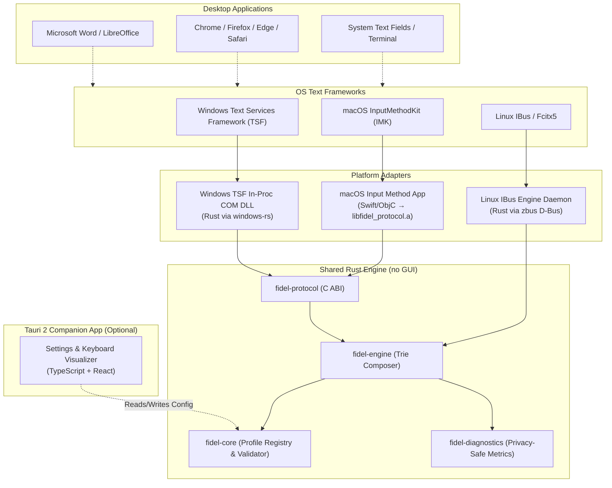
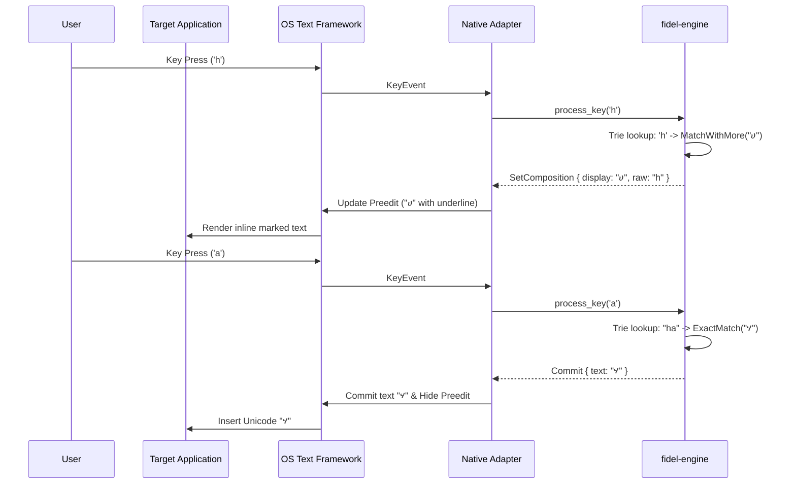

# Fidel Amharic — System Architecture

Fidel Amharic is a native, system-wide Ethiopic input method architected to provide zero-latency, Unicode-compliant typing in any application across Windows, macOS, and Linux.

## Core Architecture Principles

1. **True System-Wide Integration:** Integrates into native OS input frameworks (Windows TSF, macOS InputMethodKit, Linux IBus/Fcitx5). Never uses simulated keystrokes, clipboard paste hacks, or global keyloggers.
2. **Shared Composition Engine:** 100% deterministic Rust state machine (`fidel-engine`) shared across all operating systems.
3. **Decoupled Settings UI:** Tauri 2 is used exclusively for configuration, visual keyboards, tutorials, and onboarding. System-wide typing functions uninterrupted even when the settings app is completely closed.
4. **Declarative Layout Profiles:** All phonetic sequences, vowel orders, punctuation, and numerals are defined in versioned TOML profiles (`fidel-core`), with clean separation between engine logic and keyboard layouts.

## Component Map

## Composition Lifecycle

